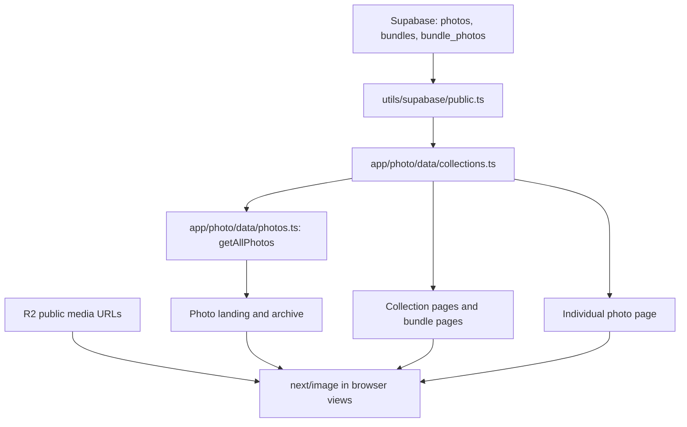

# Codebase guide and photo redesign workflow

Current implementation update: [SUPABASE_CHANGES.md](SUPABASE_CHANGES.md) records
the applied security migration, private backup tables, and independent v2 catalog.
The original route/data map below still describes the live v1 application; the
new view must use the v2 tables rather than the shared-data proposal below.

## Preview implementation map — updated November 23, 2026

The current review checkpoint is recorded in [PHOTO_PREVIEW_PROGRESS.md](PHOTO_PREVIEW_PROGRESS.md).
The old route/data map below remains a reference for the legacy application.

| Preview task | Start with |
| --- | --- |
| Shared portfolio shell, navigation, viewport behavior | `app/photo-preview/layout.tsx`, `features/photo-portfolio/components/Sidebar.tsx`, `features/photo-portfolio/portfolio.module.css` |
| Shared overview title and spacing | `features/photo-portfolio/components/PortfolioPageHeader.tsx`, `.pageHeader` in the scoped stylesheet; sequence viewers use `.viewerHeader` separately |
| Light/dark typography and palette | `features/photo-portfolio/typography.ts`, `components/PortfolioThemeSwitch.tsx`, scoped stylesheet; existing `app/providers.tsx` supplies the theme preference. See [PHOTO_TYPOGRAPHY_OPTIONS.md](PHOTO_TYPOGRAPHY_OPTIONS.md) |
| Active dark palette (beige / graphite / ink) | `features/photo-portfolio/appearance.ts`; preview layout applies `data-dark-palette`, dark-only CSS variable sets supply colors |
| Public v2 reads and demo curation | `features/photo-portfolio/data/catalog.ts`, `data/demo.ts`, `types.ts` |
| Selected Work / shared sequence viewer | `app/photo-preview/page.tsx`, `features/photo-portfolio/components/PortfolioViewer.tsx` |
| Series overview and sequences | `app/photo-preview/series/page.tsx`, `series/[slug]/page.tsx` |
| Archive controls, paging, filter/return URLs | `app/photo-preview/archive/page.tsx`, `features/photo-portfolio/components/Archive.tsx`, `components/ArchiveFilter.tsx`, `lib/archive.ts` |
| Individual photos / archive viewer context | `app/photo-preview/photos/[slug]/page.tsx` |
| About / Contact and public profile links | `app/photo-preview/about/page.tsx`, `features/photo-portfolio/data/profile.ts`; shared links also used by the sidebar |
| Static display/thumbnail images | `scripts/prepare-photo-preview.mjs --all`, `features/photo-portfolio/data/prepared-images.json`, `public/photo-preview/` |
| Archive logic checks | `node --test scripts/test-photo-archive.mjs` |

Archive URL keys: `q`, `place`, `year`, `page`. Individual photo links carry
`from=archive` plus those keys; the viewer uses `photo` for native-history sequence
navigation. Archive viewers receive filter context so return links follow the
current photograph and filtered page; the Archive focuses/scrolls to the hash card.
Only the fixed archive path is used for return links. Archive filtering
is currently client-side over the bounded public metadata catalog; revisit server
filtering if the catalog grows substantially. All current public media has local
WebP derivatives; no new remote writes or Vercel transformations are required for
these 286 images. The original public R2 objects are untouched.

The preview remains dynamic, noindex, and isolated from the old photo routes.
Slideshow/loading lock page overflow; Series/Archive/Index scroll normally.
About/Contact now has a compact factual intro and direct email/Instagram/personal
website links. The email was explicitly supplied for public display by the user.
The former generic `[section]` placeholder route has been removed. See the progress
document before proceeding past a user review checkpoint.

Last inspected: 2026-11-22. This guide describes the checked-out source, including
the uncommitted image optimization changes from this chat. It is a navigation
aid, not proof of the current production deployment. Update it when routes,
data contracts, or deployment behavior change.

Follow-up: [PHOTO_REDESIGN_BRAINSTORM.md](PHOTO_REDESIGN_BRAINSTORM.md) includes a
read-only live Supabase review performed later on the same date. Consult it for
verified schema details, content counts, policy findings, and redesign options;
the original architecture audit below was based on source alone.

## Start here

| Task | Start with |
| --- | --- |
| Personal homepage, projects, experience | `app/page.tsx`, `app/components/` |
| Photos landing page | `app/photo/page.tsx` |
| Database-to-photo mapping, collections, bundle membership | `app/photo/data/collections.ts` |
| Combined gallery tiles and archive data | `app/photo/data/photos.ts` |
| Photo types and optional presentation fields | `app/photo/types.ts` |
| Search, filters, layout preferences | `app/photo/components/PhotoSearch.tsx`, `app/photo/data/photo-filters.ts` |
| Card presentation | `app/photo/components/PhotoCard.tsx` |
| Individual photo and social metadata | `app/photo/photos/[id]/page.tsx` |
| Bundle contents and order | `app/photo/bundles/[id]/page.tsx`, `getBundlePhotos()` |
| Admin metadata writes and page invalidation | `app/photo/admin/actions.ts` |
| JPEG uploads | `app/photo/admin/components/FileUploader.tsx`, `app/api/upload/presign/route.ts` |
| Image transform settings | `next.config.ts` |
| Global theme, styles, metadata | `app/layout.tsx`, `app/providers.tsx`, `app/globals.css` |

Paths in this guide are relative to the repository root.

## Stack and repository boundaries

- One Next.js App Router app, not a monorepo. Next.js `16.0.10`, React `19.2.0`,
  TypeScript with strict checking and `@/*` mapped to the repository root.
- Tailwind CSS 4 via PostCSS. shadcn-style Radix components in `components/ui/`;
  `components.json` configures the neutral/new-york style and Lucide icons.
- Supabase supplies metadata and admin authentication. Photo binaries live in
  Cloudflare R2 and are read through `media.isaacjiang.ca` by default.
- Vercel hosts the site according to the project context. No tracked Vercel
  configuration, CI workflow, database migrations, or test suite was found.
  Dashboard settings and database policies were not inspected in this audit.
- Dependencies include Embla, react-photo-album, and yet-another-react-lightbox.
  Embla is used by the photo carousel. The latter two packages have no source
  imports in the inspected app; installation does not imply an existing viewer.
- `.env*`, `.next/`, `node_modules/`, `.vercel/`, and TypeScript build info are
  ignored. Do not include credentials or generated artifacts in documentation.

## Current routes

| URL | Entry file | Responsibility |
| --- | --- | --- |
| `/` | `app/page.tsx` | Client-rendered personal homepage; switches projects/experience/more views using local state |
| `/photo` | `app/photo/page.tsx` | Server page: curated recent work, collection covers, calendar |
| `/photo/gallery` | `app/photo/gallery/page.tsx` | Server prepares archive data/filter options; client `PhotoSearch` handles interaction |
| `/photo/gallery/[slug]` | `app/photo/gallery/[slug]/page.tsx` | Six predefined collection routes; builds bundle/standalone tiles |
| `/photo/bundles/[id]` | `app/photo/bundles/[id]/page.tsx` | Bundle description, metadata, ordered photo cards |
| `/photo/photos/[id]` | `app/photo/photos/[id]/page.tsx` | Individual published photo; previous/next navigation; Open Graph and Twitter metadata |
| `/photo/admin` | `app/photo/admin/page.tsx` | Dynamic authenticated content manager |
| `/photo/admin/login` | `app/photo/admin/login/page.tsx` | Login form and server actions |
| `/api/upload/presign` | `app/api/upload/presign/route.ts` | Authenticated POST generating a short-lived R2 upload URL |
| `/api/upload/delete` | `app/api/upload/delete/route.ts` | Authenticated POST deleting an R2 object |

The homepage gallery link lives in `app/components/PhotographyGrid.tsx` and points
to `/photo`. Other homepage content is largely defined directly in component
arrays. The particle background belongs to the homepage, not the root layout.

There is currently no `app/photo/layout.tsx`. Root layout/provider/global styles
affect public photo pages and admin alike. Adding a photo-wide layout later would
also wrap admin unless routes are deliberately separated.

## Read data flow



### Metadata model observed in source

These are the fields the app queries or writes, not a complete database schema.
Constraints, foreign keys, grants, and RLS must be checked in Supabase before any
database changes.

- `photos`: public identity is `slug`; admin mutations use a separate `id`.
  Fields include `object_key`, `title`, `date_taken`, `categories`, `alt_text`,
  `description`, `location`, `published`, and `portfolio_order`.
- `bundles`: `id`, `title`, `description`, `categories`, `date_taken`,
  `location_name`, `published`.
- `bundle_photos`: `bundle_id`, `photo_slug`, `position`. A photo can belong to
  more than one bundle. `position` controls the sequence within each bundle.
- The delete action calls database RPC `decrement_portfolio_order_after`.
  Its implementation is not present in this checkout.

### Public catalog semantics

`collections.ts` is server-only and uses `createPublicClient()` with the
publishable key, without an admin session. Public photo and bundle queries filter
`published = true`. Bundle membership is intersected with published photos so an
unpublished member does not enter the public catalog.

Public photo queries order by ascending `portfolio_order` (nulls last), then
descending `date_taken`. The landing page deliberately sorts featured tiles by
descending portfolio order and takes six. Establish the desired new portfolio
order explicitly rather than assuming these two orders mean the same thing.

`COLLECTION_DEFINITIONS` contains six code-defined categories, descriptions, and
cover object keys: landscapes, people-portraits, urban-nature, wildlife,
motion-aviation, abstract-detail. Membership comes from the corresponding category
strings in the database; collections themselves are not database rows.

`createDynamicCollection()` emits matching bundles first, then standalone photos.
A photo represented in a bundle for that category is omitted as a standalone tile.
`collection.count` counts tiles, not necessarily individual photographs.
`collection.images` expands bundle contents and standalone photos; deduplicate it
by photo ID when constructing a continuous viewer.

`getAllPhotos()` in `photos.ts` is a mixed tile catalog, despite its name:

- It traverses the six collections, converts bundles to cover tiles with
  `peekSrcs` and expanded `bundlePhotos`, and retains standalone tiles.
- It deduplicates by destination plus ID. A bundle and a standalone photo can
  coexist; the same photograph can occur inside multiple bundles.
- A bundle tile takes its photo fields from the first ordered member, then
  replaces title/description/categories/location/date with the bundle's metadata.
- Photos without a matching configured category do not enter this combined
  archive, even though direct photo lookup may still find them.

For the redesign, build a server-side adapter that returns actual photographs
and explicit series membership. Do not reinterpret a bundle tile's ID as a photo
slug. Preserve bundle order, deduplicate by the actual photo ID, and pass a small
view model to client controls.

### Type and metadata gaps

`PhotoImage` supports width, height, tags, focus point, crop, coordinates, and
album ID, but the current database select/mapper does not populate those fields.
`PhotoCard` supports focus-point positioning if supplied. The uploader reads EXIF
dates but does not persist image dimensions. Do not build a masonry layout or
sequence that assumes intrinsic dimensions are available. An initial viewer can
use a reserved stage and `object-fit: contain`.

`PhotoSearch` supports tags although the present mapper supplies none. Its layout
and bundle-mode choices are stored in `localStorage`. The pure `filterPhotos()`
helper handles text, category, location, tag, date, and bundle-mode filters; text
matching is title/alt/description. Keep new preview preference keys separate if
their meaning differs from the old view's keys.

## Rendering, caching, and links

- Photo routes are server components with small interactive client components.
  Keep database access server-side and the viewer/menu state client-side.
- `React.cache()` wraps several catalog loaders for render/request deduplication.
  It is not a persistent cache with a 31-day lifetime.
- Individual photos and bundles use `generateStaticParams()` and
  `dynamicParams = true`; collection slugs are generated with
  `dynamicParams = false`. The previous production build generated static public
  pages, including the landing page and archive; admin is force-dynamic.
- Admin `refreshPhotoPages()` calls `revalidatePath()` for the current landing,
  archive, collections, bundles, and individual photos. New statically cached
  preview routes must join this invalidation flow, or use deliberate request-time
  rendering during development. Choose this explicitly; a new URL is not
  automatically fresh after an admin save.
- Photo previous/next navigation currently uses all published photo IDs, not the
  active collection or bundle. New series navigation needs its own context.
- Destination strings are embedded throughout the existing components and data
  assembly. A parallel view needs a route builder or base-path-aware adapter so
  its collection, series, and detail links remain in the preview experience.
- `getPhotoById()` queries directly and is called by page rendering and metadata;
  do not assume it has the same `cache()` wrapper as the bulk loaders.

## Admin and upload boundaries

`admin/page.tsx`, `admin/actions.ts`, and both upload API routes verify Supabase
claims and require the subject to equal `ADMIN_USER_ID`. Login uses password
sign-in; cookies are handled by `utils/supabase/server.ts`. The public data client
is a different helper. No service-role key is referenced in the inspected source.

`utils/supabase/client.ts` provides a browser client. There is also a
`utils/supabase/middleware.ts` helper, but no root middleware/proxy entry point or
source imports wiring it into request handling were found. Its presence alone
does not establish session-refresh middleware.

Upload sequence:

1. `FileUploader` validates JPEG type and the default 30 MB limit; extracts an
   EXIF date when available.
2. `/api/upload/presign` repeats auth/type/size checks and creates an R2 key
   `camera/YYYY-MM-DD/sanitized_filename.jpg` with a five-minute signed PUT URL.
3. The browser uploads directly to R2 using XHR progress events.
4. `AddPhotoForm` submits metadata through `createPhotoAction`, optionally adding
   bundle membership. R2 upload and metadata insertion are separate operations.
5. Server actions invalidate the known photo routes after successful writes.

Deleting metadata in the admin list keeps the image object; the separate upload
delete API removes an R2 object. Avoid using production admin mutations as tests
for a presentation-only preview. A branch, route, or deployment does not copy or
isolate the Supabase database or R2 bucket.

Environment names referenced by source (values are deliberately omitted):

| Name | Purpose |
| --- | --- |
| `NEXT_PUBLIC_SUPABASE_URL` | Supabase API endpoint |
| `NEXT_PUBLIC_SUPABASE_PUBLISHABLE_KEY` | Public client key; row access depends on database policies |
| `NEXT_PUBLIC_MEDIA_BASE_URL` | Public media origin; defaults to `https://media.isaacjiang.ca` |
| `ADMIN_USER_ID` | Server-side admin subject allowlist |
| `R2_ACCOUNT_ID`, `R2_ACCESS_KEY_ID`, `R2_SECRET_ACCESS_KEY`, `R2_BUCKET_NAME` | Server-side R2 upload/delete configuration |

Keep public media origin and `images.remotePatterns` aligned if changing the
origin for previews. Preview environment variables may differ from Production;
their actual dashboard configuration remains to be verified before deploying.

## Styling and media constraints

- `app/layout.tsx` owns site-wide metadata and loads Geist font definitions.
  Font variables are defined there but are not attached to the rendered body in
  the inspected source. `next/font/google` requires font downloads during builds.
- The root starts with the `dark` class; `Providers` uses next-themes with dark
  as the default and system support. A white portfolio should scope its own colors
  without changing the global theme preference for the homepage/admin.
- `globals.css` sets `body` to `overflow-y: scroll` and `overflow-x: hidden`.
  A horizontal photo sequence needs its own bounded scrolling container, not
  body-level horizontal scrolling. Use CSS modules or feature-scoped selectors.
- Do not add a broad `/photo` layout that accidentally gives admin the portfolio
  sidebar or intercepts its navigation. A public-only route group is an option
  at cutover; route groups organize layouts but do not create a second URL.
- Current image config: minimum TTL 2,678,400 seconds (31 days), WebP, quality 75,
  device widths 640/960/1280/1920 and smaller widths 32/64/128/256/384. Local
  `/images/**`, YouTube `/vi/**`, and the media origin's `/camera/**` are allowed
  without source query strings.
- TTL applies to optimized image variants, not page metadata or database records.
  Replace photo files with new object keys to avoid stale optimized images.
- The earlier optimization work enables optimization for carousel/detail images
  and fixes several `sizes` declarations. It is still uncommitted in this audit;
  do not treat it as confirmed production behavior.
- The user supplied a Vercel alert showing all 5,000 included transformations
  consumed. No live quota measurement was performed. New viewer widths can create
  additional transformations; reuse existing width/quality choices, load a bounded
  set of photos, and test the exhausted-quota behavior before release.

## Proposed redesign workflow (not implemented)

### 1. Separate the work from the release

Use a short-lived feature branch such as `codex/photo-portfolio-redesign`, with
local review and a Vercel Preview deployment. No permanent `develop` branch,
second repository, or second Vercel project is necessary for this UI change.

At inspection the checkout is on `main` with uncommitted image optimization work.
Review and record that work in its own commit before mixing in the redesign, or
deliberately carry it to the feature branch and commit it separately. Do not reset
or stash it implicitly. A separate worktree is optional for simultaneous old/new
dev servers; a fresh worktree would not include uncommitted changes automatically.

No branch, commit, preview route, push, or deployment was created by this audit.

### 2. Add a parallel public view

Recommended initial structure:

```text
app/photo/                         # existing routes remain in service
app/photo-preview/                 # new, temporary route namespace
  layout.tsx                       # preview metadata: noindex, nofollow
  page.tsx                         # selected portfolio
  gallery/[slug]/page.tsx           # collection sequence
  bundles/[id]/page.tsx             # ordered series
  photos/[id]/page.tsx              # direct photo link / reload support
features/photo-portfolio/          # reusable new UI; not named v2 forever
  components/                      # sidebar, mobile menu, stage, captions, controls
  data/                            # server-only adapter over existing catalog
  routes.ts                        # explicit preview/live link generation
  portfolio.module.css             # scoped white portfolio presentation
```

This is a proposed structure; none of these new directories currently exists.
The new renderer should not import old visual cards or change shared catalog
semantics to fit its UI. Share the existing data loaders/types, adding a focused
adapter instead of duplicating queries, uploads, authentication, or storage.

If the preview stays exclusively on the feature branch, use its deployment URL
for review. If the preview namespace is later merged before cutover, the live
`/photo` route can still stay on the existing view. Keep experimental pages out
of navigation and search indexing. `noindex` is not access control; use deployment
protection if review access should be restricted.

### 3. Build and review incrementally

First review the shell, typography, desktop sidebar, mobile menu, and one photo
stage. Then add curated sequences, collections, bundle navigation, optional
captions, fullscreen, and a secondary archive/search entry. The reference is
`https://kiliii.com/`: white canvas, narrow sidebar, large horizontal photo
sequence, quiet controls. Adapt its mobile experience rather than copying its
fixed desktop sidebar at narrow widths.

Start with published data through read-only catalog loaders. Database/schema or
admin changes are separate work if dimensions, curation, or other requirements
actually demand them. Preview uploads/deletions need separate test resources if
they are later introduced; a Git branch alone does not provide that separation.

### 4. Verify before switching URLs

- Desktop and mobile: landscape and portrait photos preserve their full aspect
  ratio; menu and captions work without covering essential controls.
- Interaction: keyboard controls, touch/swipe, focus handling, back/forward,
  reload and direct links to a collection, bundle, or individual photo.
- Data: correct ordering, no duplicate photographs, empty collections, missing
  descriptions, invalid IDs, unpublished records, and no accidental mixing of
  bundle metadata with individual photo metadata.
- Performance: stable layout, responsive image sizes, current/nearby photo loading
  rather than the whole archive, no unnecessary new qualities or image widths,
  and a deliberate response to image optimizer quota errors.
- Regression: existing public photo URLs, personal homepage/theme, and admin
  login/upload interfaces remain functional. Do not mutate real records just to
  exercise the redesigned viewer.
- Content freshness: new routes refresh after admin changes; preview and
  production variable scopes and caching behavior are accounted for.
- Metadata: preview `noindex`; production title, canonical/social URLs and images
  describe the intended live destination. Preserve existing shared links.
- Run TypeScript and production build. Add focused tests for new ordering,
  deduplication, and navigation logic when implemented; verify real browser flows.

### 5. Cut over, then clean up

Use a small, separate cutover commit to have existing `/photo` entry points render
the tested portfolio components. Preserve `/photo/gallery/[slug]`,
`/photo/bundles/[id]`, and `/photo/photos/[id]`, or explicitly map any necessary
redirects. Changing only the homepage button would leave old direct links on the
old experience and is not a complete migration.

The new feature accepts a route base so the same implementation serves preview
and live URLs. After final review, release through the existing production
deployment workflow and check the actual live URLs. Retain the old renderer for
a short review period with a documented way to restore it, then remove old
components/routes in a separate cleanup commit. Remove or redirect temporary
preview paths and remove preview-only metadata from the live rendering.

Rollback should restore the previous renderer/route wiring without database
changes. A Vercel rollback restores deployed code, not database or R2 mutations.
Avoid introducing an external feature-flag service just for this one migration;
a small route cutover and Git history are sufficient unless rollout requirements
become more complex.

## Local commands and verification notes

```text
npm ci               # install from committed package-lock.json when needed
npm run dev          # local Next.js development server
npx tsc --noEmit     # type checking
npm run build        # production compile, type check, data loading, static generation
npm run start        # serve the completed production build locally
npm run lint         # available ESLint command; run when relevant/requested
git diff --check     # whitespace/conflict-marker check
```

The image optimization pass earlier in this chat passed TypeScript, production
build, and image config checks. This documentation pass did not rerun the app or
validate a redesign. Production builds access Supabase data and Google Fonts;
missing env values, packages, or network access can prevent verification.

The previous build warned that a parent-directory lockfile caused Turbopack to
infer a workspace root above this repository. If that warning matters for future
builds, investigate a project-scoped `turbopack.root` rather than deleting unrelated
lockfiles. No root configuration change was made here.

## Documentation sources

- [Vercel environments and Preview deployments](https://vercel.com/docs/deployments/environments)
  describe branch previews and separate environment variable scopes. The actual
  production branch, environment values, and protection settings still need
  confirmation in this project's dashboard before deployment.
- [Next.js route groups](https://nextjs.org/docs/app/api-reference/file-conventions/route-groups)
  explain layout organization without URL prefixes.
- [Vercel image limits](https://vercel.com/docs/image-optimization/limits-and-pricing)
  and [cost guidance](https://vercel.com/docs/image-optimization/managing-image-optimization-costs)
  explain transformations, caching, and exhausted-quota behavior.

For future changes, read the relevant entry files above and check the current diff
first. Treat this file as a map; source and deployment state can move ahead of it.
