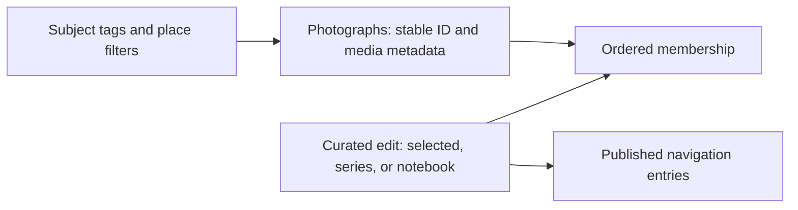

# IJ.PRIME: photo portfolio brainstorming and backend review

Implementation follow-up: [SUPABASE_CHANGES.md](SUPABASE_CHANGES.md) records the
completed bundle access fix and separate v2 tables/backups requested afterward.
The research below remains a dated exploration; its policy findings describe
the pre-fix state, and shared-table proposals are superseded by the independent
catalog decision.

Research date: November 22, 2026 (America/Toronto).

This is a finished exploration document, not an approved specification. It combines
the current source, read-only inspection of the connected Supabase project matched
to the local app configuration, a sample of the public image archive, and research
into established photographers' websites. No application, database, policy, or
deployment changes were made during this review.

For file locations and existing routes, start with [ARCHITECTURE.md](ARCHITECTURE.md).

## 1. What could this become?

The most promising direction is a personal photographic journal with an edited
front door: a calm place to look closely, with enough room behind it for all the
things Isaac photographs. It does not need to claim one narrow specialty.

The archive already suggests recurring interests: familiar places revisited,
transit and movement, changing evening light, waterfronts, people in their
surroundings, and close observation of small things. These can hold together
without turning every photograph into a landscape, portrait, or wildlife exercise.

An exploratory positioning sentence:

> Photographs from familiar places, passing moments, and things worth a second look.

Another, with less interpretation:

> A growing collection of photographs by Isaac Jiang.

Neither is final copy. We should earn a more specific statement through the edit.
Shooting many subjects is not evidence of having no style; subject, technique,
editing, and the way photographs are sequenced are different things.

**Leading proposal:** a white, spacious portfolio with a small sidebar, an edited
selection on arrival, named series, and a complete searchable archive. Use the
large-photo confidence of Kiliii's site, but develop navigation from the actual
work rather than copying his subject headings.

One backend issue deserves attention independently of that creative direction:
bundle access policies are broader than the application's admin authorization.
Section 8 records the evidence and recommended repair. This review did not fix it.

## 2. What the existing work tells us

### Catalog evidence

Live SQL counts at the time of inspection:

| Finding | Observed value | Why it matters |
| --- | --- | --- |
| Photos | 286, all published | Publication currently does not distinguish a small portfolio edit from the full archive |
| Bundles | 35 | There is already enough material for series and studies |
| Bundle memberships | 186 | Grouping matters; it is not an edge case |
| Photos with width and height populated | 0 | The schema has the fields; the ingestion and read pipeline do not use them |
| Descriptions identical to titles, ignoring case/outer whitespace | 187 | A caption panel should be optional and should not repeat the heading |
| Alt text identical to titles, using the same comparison | 283 | Accessibility work should describe meaningful visual content rather than only copy labels |
| Date range in `date_taken` | February 14–October 16, 2026 | The inspected catalog is a concentrated body of recent work, not a decades-long retrospective |

The table-list tool estimated zero rows for two tables, while direct SQL counted
35 bundles and 186 memberships. Counts here use the direct queries, not those
estimates. The deployed archive displayed 289 photos when expanded, whereas the
connected database currently has 286. That discrepancy could reflect cached output
or a different deployment data configuration; do not treat either count as a
permanent product label. Check freshness and environment alignment during QA.

Current category assignments:

| Stored category | Photos |
| --- | ---: |
| Abstract & Detail | 82 |
| People & Portraits | 65 |
| Motion & Aviation | 63 |
| Urban Nature | 33 |
| Landscapes | 25 |
| Wildlife | 17 |
| Portraits | 1 |

This is not overwhelmingly a conventional landscape portfolio. Detail,
people, and movement account for much of the catalog. Category counts describe
existing labels, not an objective evaluation of the pictures.

Repeated locations are particularly useful clues: Downtown Vancouver has 39
photos, Bridgeport Station 34, Tunnel of Trees 25, Garry Point 24, English Bay 22,
Waterloo 18, Terra Nova 18, Essex 14, and Windsor 13. Repeated access to ordinary
places can become a stronger organizing idea than a menu of faraway destinations.

### Visual observations, with limits

I inspected portions of the public contact sheet, not every full-resolution image.
Visible examples included blue flower studies, autumn foliage, couple portraits,
sunlit brickwork, silhouetted wires, trains, evening skylines, and aircraft against
colored skies. Warm/cool light, silhouettes, framing, repetitions, and variations
of one scene are useful candidate threads. These are working observations to
test through a more deliberate edit, not a definitive statement about the style.

Some thumbnails visibly failed to load during inspection. The cause was not
verified per request; it could involve optimizer limits or source availability.
Either way, robust media loading belongs in the new viewer's acceptance criteria.

### A surprisingly useful distinction inside the bundles

The existing bundles include different kinds of grouping:

- **A place revisited:** Skytrain Series, Bridgeport Cloudy Sunset Series.
- **A single outing or event:** Michigan Forests, English Bay Fireworks.
- **A visual study:** Blue Flower Series, Moon Studies, Umbrellas Study.
- **A portrait session:** Couple Portraits 1.
- **Alternate treatments:** Golden Hour Skyline includes different times/treatments;
  the Bridgeport description explicitly mentions varying editing styles.

Those do not all need the same public treatment. A ten-frame flower study might
be a wonderful notebook while contributing one photograph to Selected Work.
An event album can stay available without becoming a flagship project.

## 3. Useful reference photographers

Established recognition helps identify work worth studying; it does not make
every part of an artist's website appropriate here. These examples were chosen
for a specific lesson. The proposed applications are my interpretations.

| Reference | What I inspected | Useful lesson for this site | What I would leave behind |
| --- | --- | --- | --- |
| [Kiliii Yuyan](https://kiliii.com/) | Homepage, project thumbnails, a photo series, captions, keyboard navigation, narrow-screen behavior | Persistent navigation, generous photographs, optional context, a sequence that feels intentional | His professional sections and geography are specific to his practice; the fixed sidebar is cramped on a narrow screen |
| [Alec Soth — Sleeping by the Mississippi](https://alecsoth.com/photography/projects/sleeping-by-the-mississippi/) | Large-photo gallery and alternate Index view | One project can connect people, rooms, objects, and places. Offer both a slow viewing mode and an index | A book cover as the opening image makes sense for this published book; Isaac's opening should usually be a photograph |
| [Rinko Kawauchi — Works](https://rinkokawauchi.com/en/works/) and [Illuminance](https://rinkokawauchi.com/en/works/194/) | Work titles, secondary navigation, a quiet multi-image presentation | Light and visual relationships can unite unlike subjects. A series title can suggest an idea without naming a genre | Her sparse, subtle navigation can be hard to discover; retain clear active states, readable text, and obvious controls |
| [Reuben Wu](https://reubenwu.com/) | Large selected-work presentation, navigation, numbered sequence | A small number of clear viewing modes can support varied work; let the pictures carry the visual identity | His commissions, monographs, on-chain work, and media-heavy presentation serve a different business/practice |

Recognition checks: Soth's work is documented by the
[Deutsche Börse Photography Foundation](https://www.deutscheboersephotographyfoundation.org/en/collect/artists/alec-soth.php);
Kawauchi's [biography](https://rinkokawauchi.com/en/biography/) lists substantial
museum exhibitions and awards; Wu's [biography](https://reubenwu.com/about/) lists
museum collections and commissioned work. These are reasons to examine the work,
not reasons to imitate their identities.

Kawauchi is particularly relevant as a reminder that ordinary details and larger
scenes can belong together. Soth is relevant to mixing subjects within a sustained
place or journey. Kiliii is the strongest layout reference; Wu is useful for
separating selected work from other modes of practice.

I also looked for Sam Youkilis's site as an everyday-observation reference, but
could not inspect it successfully with the web reader. I have not treated its
layout as evaluated evidence.

## 4. Navigation: several credible directions

Use navigational links that name destinations. These are not all ARIA tabs;
collection and photo URLs should work on direct entry and browser back/forward.

### Option A — edited portfolio plus open archive (recommended starting point)

```text
IJ.PRIME
Isaac Jiang

Selected Work
Series
  Between Stops
  Edges of the Day
  Small Worlds
  ...
Archive

About / Contact
Personal website
```

**Selected Work** is a manually sequenced introduction, initially perhaps 18–24
photographs. That number is a starting constraint for an editing exercise, not a
rule. It should show breadth without including every near-duplicate or recent upload.

**Series** holds sustained ideas, locations, or visual investigations. Start with
two or three convincing edits rather than publishing every proposed title.

**Archive** retains all publicly intended photographs with useful conventional
filters. Having a complete archive removes pressure to put everything on the front.

**About / Contact** can be one compact page. Keep a separate link to the personal
website so visitors understand the relationship between the portfolio and Isaac's
other work. Instagram belongs here or in a quiet footer, not beside every image.

Add **Notebooks** later if alternate edits, short experiments, and notes become a
real recurring practice. It should not launch as an empty blog commitment.

Why this is the leading option: the structure stays useful as the subject matter
changes. The personal character comes from the photographs and named series,
without forcing a permanent specialty.

### Option B — a few thematic shelves, closer to Kiliii's navigation

```text
Selected
In Passing
Along the Water
Light Studies
Small Worlds
Archive
About
```

| Shelf | What could belong | Important boundary |
| --- | --- | --- |
| In Passing | Trains, aircraft, crossings, commuters, people encountered on walks | Select for movement, waiting, or encounters; do not simply dump all vehicles here |
| Along the Water | Garry Point, Iona, English Bay, shorelines, figures by water | Let place/experience connect people and scenery |
| Light Studies | Reflections, silhouettes, dusk, windows, lightning, long exposures | Include a picture because light is its subject, not merely because it has good light |
| Small Worlds | Flowers, insects, textures, fragments, intimate observations | Choose scale and attention as the link, rather than treating this as miscellaneous |

This makes the themes immediately visible. Its weakness is overlap: one sunset
train photograph could fit three shelves. That is acceptable if membership is
many-to-many and the navigation is presented as different readings of the work,
not a rigid filing system. Avoid publishing too many nearly identical shelves.

### Option C — place and return

```text
Selected
Vancouver & Richmond
Ontario
Away
Studies
Archive
About
```

The strength is honesty: the catalog has real density around repeated locations.
Series underneath could be more specific than the top-level geography. The weakness
is that Ontario and Away may feel uneven beside Vancouver, and cities are not
necessarily the artistic subject. This is useful if the pleasure of revisiting
places is what Isaac wants the portfolio to express. It should not become a travel
bucket list or use grand regional labels with little supporting work.

### Names worth testing against actual photographs

These are provisional editorial titles, not claims that the projects already exist.

| Candidate | Existing material to audition | Why it could work | Watch out for |
| --- | --- | --- | --- |
| Between Stops | Bridgeport/Skytrain, station light, passengers, nearby aircraft and bridges | A particular place becomes a study of transit and waiting | Do not broaden it until it loses its center |
| Edges of the Day | Garry Point, Iona, evening waterfront figures, silhouettes, city light | Evening as a shared experience across subjects | Many beautiful sunsets can still make a repetitive sequence |
| Along the Water | English Bay, Iona, Garry Point, Michigan shore | A physical boundary ties together people and landscape | Needs more than scenic variety |
| Small Worlds | Blue flowers, flower fields, ladybugs, butterflies, details | Supports attention and changes of scale | A better fit for visual studies than unrelated close-ups |
| The Familiar, Again | Repeated views at Bridgeport/Garry Point and changing weather | Makes returning to ordinary places the actual idea | Requires evidence of return, not just many photos from one visit |
| Passing Company | Street encounters, English Bay crowd, commuters | Connects human presence and brief proximity | Do not imply personal stories about strangers that are unknown |
| Light Held Still | Fireworks, lightning, long exposures, reflections | Technique can become a coherent investigation of time/light | Keep it from becoming an effects demonstration |
| Michigan, October | Forests, shore, town fragments, figures | A grounded, understandable short travel sequence | Edit the outing; do not rename the entire camera roll as a project |
| Blue, Repeated | Blue Flower study and carefully chosen related forms | A small, honest experiment can be stronger than a large abstract theme | The expanded version needs real visual relationships |
| A Season in Vancouver | Existing February–August Vancouver/Richmond work | Makes a bounded chapter without claiming a retrospective | Use the actual date range and avoid inventing a personal narrative |

Avoid replacing Landscape with something vague like Wander and Portrait with Souls
just to sound less generic. Plain subject labels remain useful filters. A project
title becomes meaningful through the work and sequence underneath it.

## 5. What should the new view look and feel like?

Three presentation prototypes are worth comparing before implementing the full catalog.

| Prototype | Experience | Strength | Cost / tradeoff |
| --- | --- | --- | --- |
| Large horizontal sequence | Narrow sidebar; tall images and a glimpse of the next frame | Closest to the reference; gives sequence and rhythm | Needs clear navigation and careful touch/trackpad behavior |
| Vertical photographic essay | Sidebar or quiet header; images at varied sizes with occasional pairs and text | Natural mobile scroll; supports short stories and context | More editorial layout work; less direct reference resemblance |
| Contact sheet plus focused viewer | Thumbnail overview opens a large viewer and returns to the same position | Fast browsing; strong complete-archive behavior | Easy to slip back into a dense image-management interface |

Recommendation: use the first for Selected Work and series, with a contact-sheet
toggle like Soth's Index. Use the third for Archive. A vertical essay can be a later
series presentation option when a real project needs it. Do not build three
independent viewer engines for the first release.

### Desktop behavior

- White or neutral near-white canvas, dark readable navigation, generous spacing.
  Compare white with one very light neutral on actual photographs before deciding.
- A sidebar around 200–240 pixels wide is a starting point, not a fixed requirement.
  Brand, active section, and current series should be easy to distinguish.
- Preserve full photo proportions. Use containment for the viewing stage; reserve
  cropping for intentional thumbnail covers with a focal point.
- A short series title and unobtrusive count can sit near controls. Show a clear
  next/previous affordance without displaying metadata on every image.
- Optional captions, fullscreen, and Index. No automatic slideshow by default.
  Users should control how long they look at a photograph.
- Native horizontal scrolling inside a bounded region; do not hijack every vertical
  wheel gesture on the page. Keyboard commands should not fire while typing in search.
- Keep body typography and controls comfortably readable. The references' tiny
  gray text is not a requirement to copy.

### Mobile behavior

- Replace the sidebar with a compact identity/header and an explicit menu.
- Let users swipe between photos or use visible previous/next buttons. A landscape
  photo should show fully even if that leaves empty vertical space.
- Keep caption expansion optional. Avoid a permanent sidebar or text panel that
  takes most of the screen, as the reference did at the narrow width inspected.
- Use dynamic viewport sizing and account for browser bars/safe areas. Test portrait
  and landscape orientation, touch zoom, focus, and reduced-motion preferences.
- Back should return to the same archive/filter state, not the beginning of 286 images.

### Useful details that are easy to miss

1. **Series context:** previous/next should follow the series the viewer entered,
   rather than jump through the entire database. A direct photo URL still needs
   a sensible fallback context.
2. **Index and sequence share the same edit:** switching modes must not silently
   change photo order or membership.
3. **No dead ends:** the final frame should provide a quiet return to the index or
   another series, without forcing infinite scroll.
4. **Intentional repeats:** a photo may appear in Selected and a series. Deduplicate
   within a sequence; do not ban useful reuse across contexts.
5. **Captions versus alt text:** a factual caption and a visual accessibility
   description serve different jobs. Do not auto-generate fictional context.
6. **Portrait sessions:** keep explicit decisions about which photographs may be
   published or featured. A public album does not have to be in the homepage edit.
7. **Alternate edits:** allow two versions to be related without showing every edit
   together in Selected. An optional notebook diptych could make the comparison useful.
8. **Dates:** display recorded photo dates, not storage folder names; 22 current
   dated-folder keys differ from `date_taken`. That may reflect EXIF/local-date
   handling or corrected metadata, not necessarily errors to bulk-fix.
9. **Locations:** normalize place data separately from display labels. Do not add a
   precise GPS map merely because the database could hold coordinates.
10. **Failure states:** image load retry or a deliberate fallback, empty series,
    unpublished/removed photos, and a missing-media report for admin.
11. **Open Graph/direct links:** individual images should remain shareable even when
    the main experience feels like a continuous gallery.
12. **Image protection:** disabling right-click is not effective access control.
    Publish suitably sized files and retain originals separately if needed.

## 6. Functionality to plan, and functionality to defer

| First release | Next if useful | Only with a demonstrated need |
| --- | --- | --- |
| Edited Selected Work | Short visual notebooks | Print shop, payments, shipping |
| Two or three sequenced series | Diptych / alternate-edit comparison | Visitor accounts and public favorites |
| Complete archive with search and basic filters | Place-based pages with edited introductions | Likes, comments, social-feed features |
| Large viewer, Index, captions, mobile controls | Private client delivery, as a distinct secured feature | Map with exact coordinates |
| Stable direct URLs, back/forward, focus handling | Contact sheet editor for admin | AI similarity search or automatic aesthetic scoring |
| Admin cover selection and sequence ordering | Export/share a selected sequence | A CMS or infrastructure rewrite |
| Dimensions and reliable image delivery | Film/gear notes if the work calls for them | A video section without an actual body of video work |

The admin editing experience is a central dependency, not an afterthought.
If maintaining Selected Work requires code changes, it will drift toward newest
uploads again. Plan a contact sheet that can select, order, set a cover, and preview
an edit. Saving an edit as a draft should not require hiding every photo it contains.

## 7. How the data model could support this

Keep Supabase for metadata/authentication and R2 for image files. Nothing in the
design exploration justifies moving the images into a new storage platform.

Separate four concepts that the current implementation partly conflates:



### A practical staged model

**Photos:** keep UUID identity, slug, object key, date, title, alt text, caption,
location, publication state, and timestamps. Start actually using `image_width`
and `image_height`. Optional later fields include thumbnail focal point, media
version/checksum, file size, and a relation to an alternate edit. Add fields because
a real UI needs them, not as an unused EXIF dump.

**Curated edits:** a database-managed title, slug, short introduction, kind
(`selected`, `series`, perhaps `notebook`), cover, display order, and draft/published
state. One Selected edit can be a special case rather than another global ranking
column on every image. Preserve existing bundles while deciding which should
become full series and which are simply archive groupings.

**Membership:** edit ID, stable photo UUID, and position. The same photo can belong
to several edits and have a different position/caption in each if genuinely needed.
A cover should belong to the edit or have a clearly defined fallback.

**Archive vocabulary:** subject filters, places, and optional tags. Category labels
should not decide whether a published photo exists in the archive. Renaming a menu
item should not strand photographs that have the older label.

There are two sensible implementation sizes:

- **Small first step:** enhance existing bundles with explicit curation/cover/order
  behavior, keep a separate Selected membership, and centralize categories. This
  minimizes migration work and is enough for the prototype.
- **More flexible later model:** `edits` and `edit_photos` for selected/series/notebooks,
  separate tag/place relations, redirects for slug history. Introduce this when the
  editor actually needs it, preserving old URLs and existing IDs.

Choose after editing the first sequences. The creative experiment should not wait
for a large schema redesign. Draft edit publication must still respect each member
photo's own publication state.

## 8. Supabase and ingestion review

### What is already working in our favor

- All three content tables have RLS enabled.
- Public photo reads are limited by a published-photo policy. Photo writes use a
  specific admin identity policy, rather than all authenticated accounts.
- Next server actions and upload endpoints check claims against `ADMIN_USER_ID`.
- The public loader is separated from the cookie-aware admin client and filters
  unpublished photos out of bundles.
- Photos have UUID primary keys and unique slugs/object keys/portfolio positions.
- Membership has a composite primary key preventing the same photo from appearing
  twice in the same bundle. Foreign keys already cascade slug updates and deletions.
- The browser uploads directly to R2 through a five-minute signed URL; it does not
  need R2 credentials. This is an appropriate boundary to retain.

### Confirmed findings and priorities

| Priority | Finding and evidence | Recommended treatment |
| --- | --- | --- |
| Before expanding the admin | `bundles` and `bundle_photos` write policies target `authenticated` with `true` predicates; grants also permit writes | Replace broad write authorization with the intended admin check for INSERT/UPDATE/DELETE; test admin, non-admin, and anon separately |
| Before relying on drafts | Both tables have unconditional public SELECT policies alongside narrower published-only policies; they are permissive | Remove/consolidate the unconditional policies. Adding another narrow policy alone does not fix OR-combined access |
| Before viewer layout depends on dimensions | Width/height columns exist, all 286 are null, and the public mapper does not select them | Extract dimensions for new uploads, backfill existing public files carefully, map fields into `PhotoImage`, validate positive dimensions |
| Before curating the new navigation | Collections and category choices are hardcoded in multiple files | Centralize vocabulary initially; move curated edit/navigation metadata into the database when the editor is ready |
| Before claiming complete archive coverage | `Couple Under Blossoms` is labeled only `Portraits`; app collections match `People & Portraits` | Audit/normalize this record and decouple the complete archive from collection definitions. The photo can still appear through a bundle or direct link |
| Before more complex multi-step saves | `updatePhotoAction` ignores errors from membership INSERT/DELETE loops; writes are separate requests | Check every result and use an authenticated, appropriately authorized database transaction/RPC for atomic metadata/membership changes |
| Before trusting every success message | Create/update partial-success branches can return before `refreshPhotoPages()` | Revalidate successfully changed data even on partial completion, or make the intended mutation atomic and report failures accurately |
| Before batch/concurrent editing | New positions use read-max-then-add-one; global photo order is unique | Allocate/reorder atomically. Two concurrent requests can choose the same number; do not derive editorial importance from insertion order |
| Before relying on modification timestamps | `updated_at` has a default, but no content-table triggers were found and app updates do not set it | Set timestamps consistently in the database or every mutation; a default only handles insertion |
| Routine hardening | Advisor flags mutable search path on `decrement_portfolio_order_after`; it is invoker-rights and callable by anon/authenticated | Qualify referenced tables/set a controlled search path and scope execution. Do not describe it as a security-definer bypass; it is not one |
| Routine query hygiene | Advisor reports missing index covering membership `photo_slug` | Add an index through a tracked migration and verify queries; the current small dataset does not justify elaborate performance infrastructure |
| Before future schema work | No migrations or generated database types are tracked locally | Establish a schema baseline and generated types; remove hand-cast row shapes where possible |

**Access-control scope:** the broad bundle policies allow signed-in accounts with
the authenticated role to modify bundles/memberships directly, bypassing the Next
admin UI. Public read policies permit draft bundle metadata/membership disclosure.
This does not mean arbitrary users can modify photo rows: those policies have the
narrower admin predicate. No exploit writes, signups, or test records were created.

Supabase's [RLS guidance](https://supabase.com/docs/guides/database/postgres/row-level-security)
and [permissive-policy explanation](https://supabase.com/docs/guides/observability/advisors?queryGroups=lint&lint=0006_multiple_permissive_policies)
support the distinction: an application's `.eq('published', true)` filter is not
database authorization, and permissive policies allow access through any matching
policy. Policy names have no enforcement effect.

The security advisor also reports leaked-password protection disabled. Check its
[availability and setup](https://supabase.com/docs/guides/auth/password-security)
for the current plan. Treat it as account hardening after correcting the content
policies, not as a substitute for them.

### Source-level reliability issues worth budgeting for

**Slug changes.** Membership foreign keys already use `ON UPDATE CASCADE`, so
renaming a photo slug does not by itself orphan its memberships. It can still break
old shared URLs, and current invalidation only gets the new slug. Retain old-slug
redirects and invalidate both destinations when implementing rename support.

**Renumbering after deletion.** Photo deletion happens before a separate RPC
decrements all later global positions. If the second step fails, the deletion has
already happened. Gaps in ranking are harmless; avoid renumbering the entire
catalog on every delete if explicit per-edit ordering removes that need.

**Duplicate positions.** No duplicate bundle positions were found, but the schema
has no uniqueness constraint on `(bundle_id, position)`. Decide how ordering and
drag-and-drop transactions should behave before adding a constraint that could
make intermediate reorder operations fail.

**Session refresh.** The middleware helper is not wired into a root proxy and
does not itself call a claims/user validation method to trigger refresh. Review
the [current Supabase SSR integration](https://supabase.com/docs/guides/auth/server-side/nextjs)
for Next 16. Scope auth-refresh behavior to routes that need it so public portfolio
rendering does not become cookie-dependent unnecessarily. Do not remove the
existing claims/admin checks while making that change.

**Metadata model drift.** Generate [database types](https://supabase.com/docs/guides/api/rest/generating-types)
and map database fields explicitly. The schema has dimensions that the app omits;
the frontend type also advertises tags/crop/focus data that the current mapper
does not supply. Clear types make those gaps visible.

**Scale.** Bulk catalog loaders are request-deduplicated with React cache, while
some detail lookups query individually. The full archive is passed to client
search, and the gallery assembles data via the configured collections. That is
manageable at 286 photos. Separate a lightweight public index from full viewer
metadata and add pagination if the archive grows; do not add Realtime, vectors,
or a separate search service for the sake of this redesign.

### Media pipeline improvements, alongside Supabase

These are R2/ingestion concerns, not defects in the metadata database:

- The key is date plus sanitized filename. Uploading the same filename for the
  same date can replace an object. Use immutable/versioned keys or an explicit
  replacement flow, especially with the 31-day optimized cache.
- Upload and metadata insertion are separate. Record pending/completed status or
  provide recovery for orphan uploads; do not automatically delete an uploaded
  object that another record may reference.
- MIME type supplied by a client is not byte-level JPEG validation. Validate
  actual media and dimensions during trusted processing if the upload pipeline
  expands. Keep upload limits and error messages consistent.
- Distinguish thumbnail, display-sized image, and original. Pre-generated display
  derivatives served from R2/CDN are a credible alternative to per-request Vercel
  transforms for a largely static portfolio. Compare operational effort and bytes,
  not just the transformation count.
- Do not globally bypass optimization while sending 30 MB files to small screens.
  A quota fallback must account for transfer size; original-on-error is a short-term
  continuity measure, not the final delivery strategy.
- Metadata RLS does not make an already public R2 object private. A future private
  client gallery requires genuinely private media delivery, not just a hidden slug.
- Store only useful public EXIF. Camera settings could be optional; precise GPS
  should not become public accidentally during a metadata backfill.

The current Supabase region is US West; actual production function region and
latency were not measured. Do not migrate the database during a UI overhaul just
because the account owner is in Toronto. Measure before changing infrastructure.

## 9. A concrete editing exercise before coding

1. Assemble a contact sheet of roughly 40–50 candidates across dates and subjects.
   This is a review set, not the final number of public images.
2. Make a first Selected edit of about 20 photographs. Avoid adjacent near-duplicates;
   show one representative from a session unless a pair earns its place.
3. Make three short sequences from existing material: Between Stops, Edges of the
   Day, and one study or Michigan outing. Try an opener, a change of scale, a
   quieter frame, and an ending. A sequence need not follow capture time.
4. Compare the same edit in a large horizontal viewer and a simple vertical flow.
   Choose the presentation after seeing actual portrait and landscape frames.
5. Test the names with someone who has not seen the archive. Can they predict
   what is behind each link? Pair evocative titles with a plain one-line explanation.
6. Decide whether Notebooks has enough distinct purpose to launch. If not, omit it.

This exercise will answer more than trying to invent a permanent photographic
identity before looking at the edit. A wider archive can coexist with a coherent
front page.

## 10. Recommended implementation order

1. **Independent backend repair:** tighten bundle authorization and draft reads;
   verify role behavior through read/write tests in an appropriate test environment;
   record migrations. This deserves a separate change from the redesign.
2. **Curation decisions:** choose initial photos, sequences, and navigation. Decide
   whether the smallest bundle enhancement is sufficient for the first release.
3. **Data preparation:** populate/map dimensions, clean category drift, and define
   an explicit Selected sequence. Preserve existing IDs, slugs, and publication rules.
4. **Parallel prototype:** short-lived `codex/photo-portfolio-redesign` branch,
   `/photo-preview` namespace, new scoped components, shared read-only catalog.
   Keep existing `/photo` pages available as already proposed in ARCHITECTURE.md.
5. **Viewer completeness:** direct links, series-aware navigation, caption/index
   behavior, mobile menu, accessibility, loading/failure states, image budgets.
6. **Editor support:** draft edit, set cover, reorder, preview, publish; transaction
   handling and invalidation must cover the new routes.
7. **Review and cutover:** confirm the preview with real work, test the production
   configuration, switch stable photo routes in a small commit, then remove old UI
   only after a review period. A deployment rollback does not undo database changes.

No full database rewrite, separate public site, long-lived development branch,
or new commerce/account system is required for this direction.

## 11. Decisions to revisit together

- Should the first impression be quiet observation, dramatic light, human moments,
  or an intentionally varied mix? Choose through photographs, not adjectives alone.
- Are the portrait sessions a service to promote, personal work, or simply part of
  the archive? That determines whether a future Commissions link makes sense.
- Does Isaac enjoy writing short notes, or should the site remain almost wordless?
- Should viewers see a place-based journey or a cross-location visual sequence first?
- Are alternate edits part of the public practice, or primarily private experiments?
- Which name leads: IJ.PRIME with Isaac Jiang underneath, or Isaac Jiang with
  IJ.PRIME as the portfolio identity? Keep authorship clear either way.
- Is white permanent for the portfolio, or should a quiet viewer-only dim mode be
  optional? Do not let that toggle unexpectedly change the personal homepage theme.
- What is the smallest editing interface that will make maintaining the site enjoyable?

## 12. Future feature: photo sharing

Status: planned; not yet implemented. See [the implementation plan and manual
review milestones](PHOTO_SHARING_PLAN.md).

- Add a Share button to each photo.
- Generate a polished, framed version of the selected photo with Isaac's watermark
  embedded in the exported image. Preserve the photo's aspect ratio.
- Let visitors download the generated image or copy it to their clipboard.
- Make this watermarked sharing flow the only supported public copy/download path.
  Keep unwatermarked full-resolution originals inaccessible through public image
  URLs, page markup, and image delivery endpoints; serve appropriately sized display
  images on the website instead. Disabling right-click alone cannot enforce this.
- Browser-visible images can still be saved or captured in screenshots. The access
  requirement is to protect full-resolution originals, not promise that displayed
  photos cannot be copied.

Before implementation, settle the frame design, watermark asset and placement,
export resolution, and clipboard fallback for unsupported browsers.

## Research and verification notes

Evidence includes source review, live schema/constraint/policy/function inspection,
aggregate/content SELECT queries, security and performance advisors, and browser
inspection of the current archive and reference sites. No secrets, admin IDs,
or raw database dumps are included in this document. Actual production variable
values, signup configuration, bucket access rules, media response failures, and
all individual images were not exhaustively audited.

Technical references:

- [Supabase RLS](https://supabase.com/docs/guides/database/postgres/row-level-security)
- [Permissive policy composition](https://supabase.com/docs/guides/observability/advisors?queryGroups=lint&lint=0006_multiple_permissive_policies)
- [Supabase SSR client integration](https://supabase.com/docs/guides/auth/server-side/nextjs)
- [Database type generation](https://supabase.com/docs/guides/api/rest/generating-types)
- [Function search-path advisor](https://supabase.com/docs/guides/database/database-linter?lint=0011_function_search_path_mutable)
- [Vercel image usage guidance](https://vercel.com/docs/image-optimization/managing-image-optimization-costs)
- [Vercel image limits and exhausted-quota behavior](https://vercel.com/docs/image-optimization/limits-and-pricing)

The Supabase changelog was checked during research. The current exploration does
not require SDK upgrades, branch merges, or new database features. Recheck relevant
documentation when moving from this plan to implementation.
